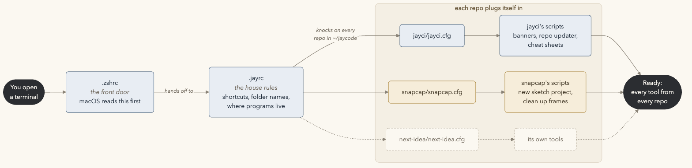
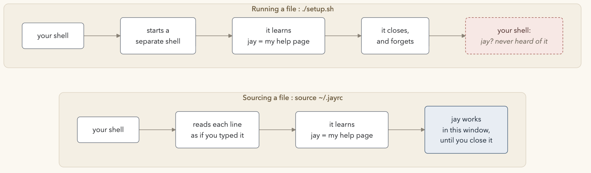
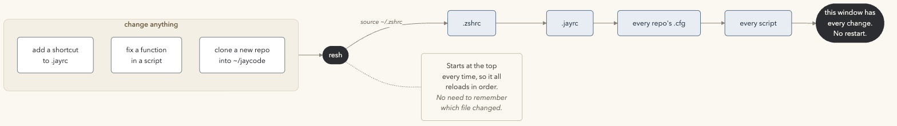
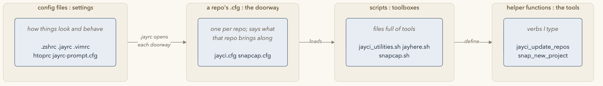
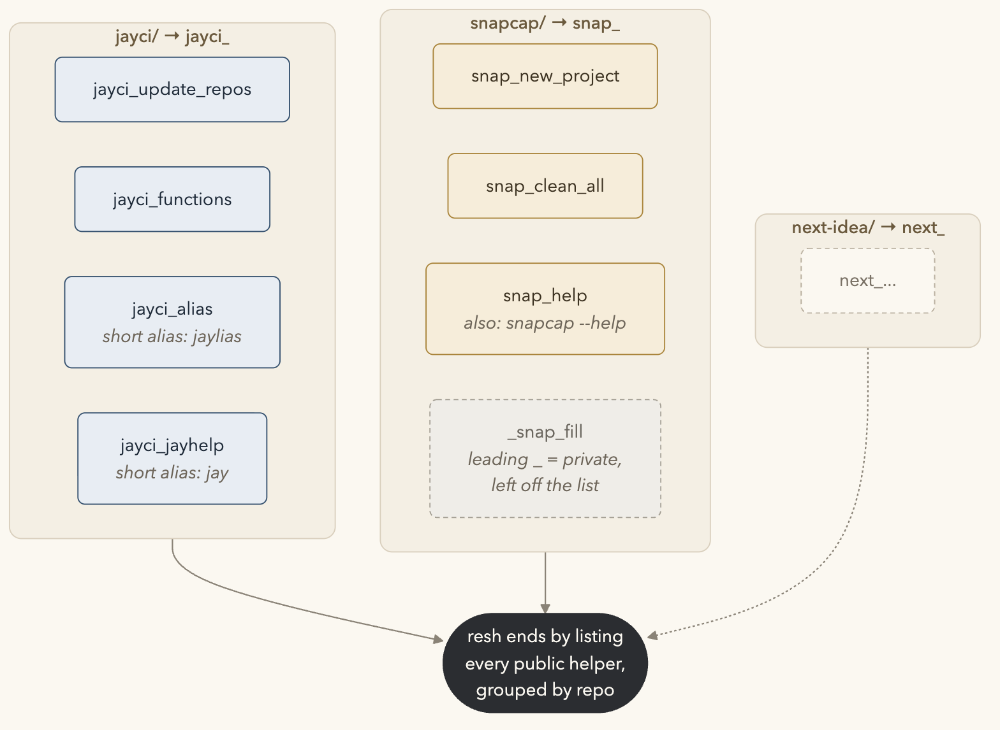
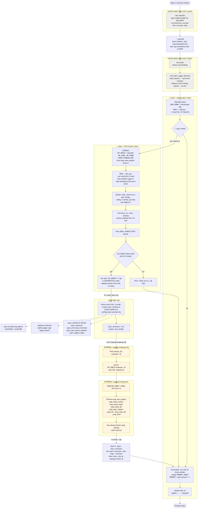
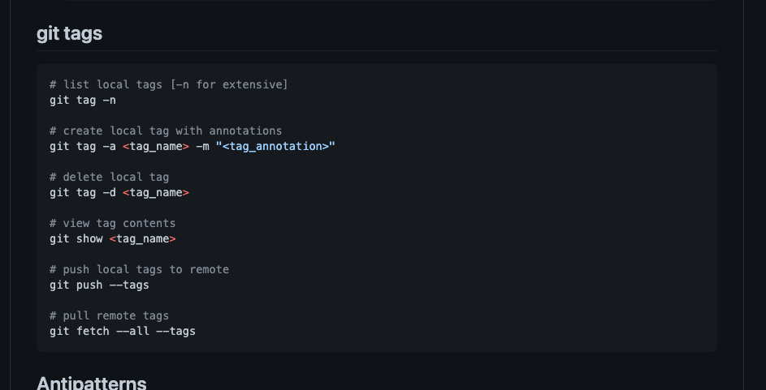
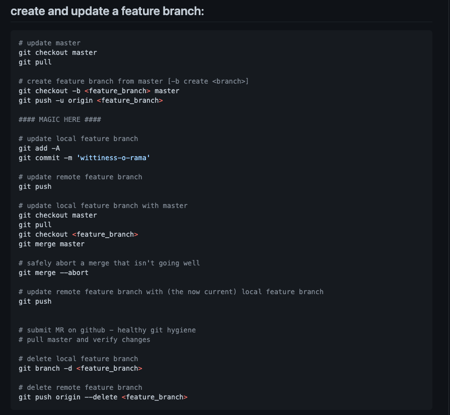
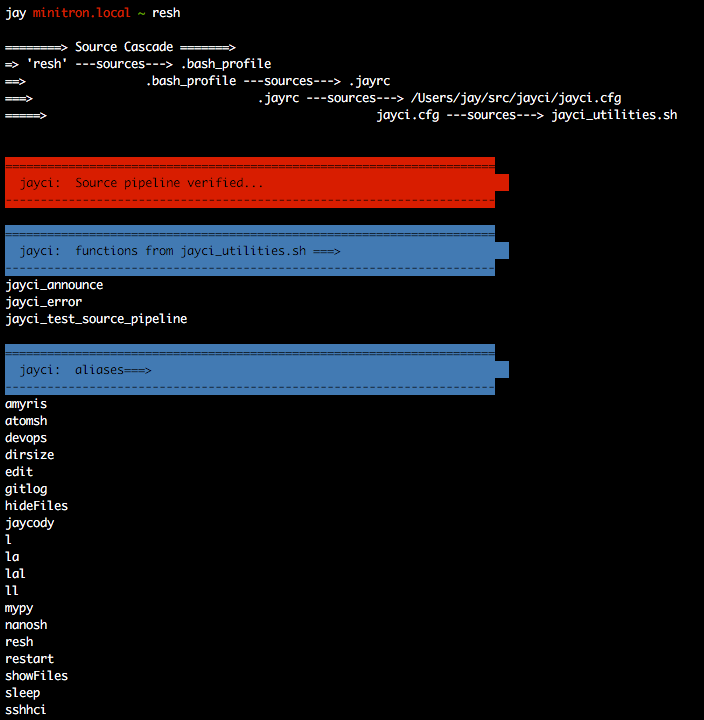

# jayci
> Mini CI/CD framework for my personal projects
__________________

## What this is
_(added 2026-11-10)_

Every new terminal window starts out blank. It has no shortcuts, doesn't
know where my projects live, and has no memory of how I like things set up.
**jayci is how my terminal remembers me.** It's a small set of plain text
files (settings, shortcuts, cheat sheets and small tools) that load
themselves the moment a window opens.

Think of setting up a studio before a day of work: lights on, brushes laid
out, reference notes pinned to the wall. jayci does that for my code studio,
in about a second, every time.

Why it has its own repo:
- **One home for how I work.** Every setting lives here, not scattered around
  the Mac. The files macOS looks for in my home folder are just links back to here.
- **A new computer in one step.** `./install.sh` sets up a fresh Mac the way I
  like it. (That's how this Mac was set up, on 2026-11-09.)
- **Projects bring their own tools.** Each repo, like snapcap (my sketch-capture
  tool), plugs its own commands in, and jayci loads them all.
- **A memory aid.** `jay` prints my quick reference page; git cheat sheets are
  one command away.
- **A record of how I've grown.** Old code isn't deleted. It moves to a
  FOSSIL RECORD at the bottom of its file, with a date and a reason.

__________________

## The big ideas, in pictures

### 1. The chain: each file hands off to the next


Nothing loads everything at once. Each file does its part, then passes the
baton, like a daisy chain:

1. macOS only knows about one file, **`.zshrc`**. It sources `.jayrc`.
2. **`.jayrc`** sets the house rules (shortcuts, folder names, where programs
   live), then walks through every folder in `~/jaycode` and sources any
   `<repo>.cfg` it finds at the top level.
3. Each **`<repo>.cfg`** sources that repo's own scripts.

Why a chain:
- **jayci doesn't need to know about my other repos.** A repo joins by having
  a `.cfg` file. Clone it into `~/jaycode` and its tools show up; delete the
  folder and they're gone. There's no list to keep up to date.
- **Tools live next to the work they serve.** snapcap's commands are in the
  snapcap repo, not in jayci.
- **Shared basics come first.** `.jayrc` loads before any repo, so every repo
  can use its shortcuts and `JAY_SPACE`. Repos then load in alphabetical order.
- **I can watch it happen.** Each link prints a banner as it loads, so if
  something is missing I can see where the chain stopped.

### 2. Why "source" anything?


Running a script starts a separate, temporary shell. Whatever the script sets
up (shortcuts, folder names, functions) disappears when that shell closes.
**Sourcing** reads the file into the shell I'm actually using, as if I'd typed
each line myself, so everything it defines stays.

Running a file is asking someone else to memorize something. Sourcing is
memorizing it yourself. Settings and tools only stick if they're sourced.

### 3. One word reloads everything: `resh`


`resh` (re-shell) is short for `source ~/.zshrc` (or `~/.bashrc` on a bash
machine). It starts at the top of the chain, so one word reloads every link,
in order:
- I don't have to remember which file I changed, or which file loads it.
- No closing and reopening windows.
- A newly cloned repo's tools show up right away.
- It ends by listing every helper function, grouped by repo, so I can see
  what's loaded.

`resh` refreshes the window it's typed in. Other open windows keep the old
setup until I `resh` there too.

### 4. Config files, scripts and helper functions


| Kind | What it's for | Examples |
|------|---------------|----------|
| **Config files** | Settings: how the prompt looks, which shortcuts exist, where programs live, how vim and htop behave | `.zshrc` `.jayrc` `.vimrc` `configs/` |
| **A repo's `.cfg`** | The doorway: plugs the repo into the chain and says what it brings | `jayci.cfg` `snapcap.cfg` |
| **Scripts** | Toolboxes: files that define helper functions | `scripts/jayci_utilities.sh` `snapcap.sh` |
| **Helper functions** | The tools: commands I type | `jayci_update_repos` `snap_new_project` |

**Why config files?** Without them I'd redo the same setup every session, and
every computer would behave a little differently. With them, how I like things
is written down once, kept in git, and the same on any Mac.

**What are scripts good for?** Anything with several steps that I do more than
twice: pulling every repo, starting a new sketch project with the right
folders, clearing out old frames. A function turns a dozen steps into one
word, and does them the same way every time.

### 5. Every repo brings its own helpers, and names them


Each repo carries the helpers for its own work, so they travel with it: clone
snapcap anywhere into `~/jaycode` and `snap_new_project` comes along.
The naming rules keep a growing pile of commands readable:

| Convention | Example | Why |
|------------|---------|-----|
| Each repo has a `<repo>.cfg` at its top level | `snapcap/snapcap.cfg` | `.jayrc` finds it (`~/jaycode/*/*.cfg`) and plugs the repo in |
| The `.cfg` sources its scripts in a loop | `for f in .../*.sh` | every script loads, not just the first |
| Public helpers start with the repo's prefix | `jayci_`, `snap_` | says where a command came from; no name clashes between repos; type `snap_` then Tab to see every snapcap tool |
| A leading `_` marks a private helper | `_snap_fill` | used by other functions, not typed by me; left off the list |
| Everyday commands get a short alias | `jay`, `jaylias` | quick to type; the full name still says where it lives |

Adding a new repo to the chain:
```bash
~/jaycode/next-idea/
    next-idea.cfg   # for f in "${JAY_SPACE}"/next-idea/*.sh; do [ -f "$f" ] && . "$f"; done
    next-idea.sh    # next_do_thing () { ... }
# then: resh
```

__________________

## How jayci works (diagrams)
_(added 2026-11-09)_ Each one is drawn from the code and checked against a live shell on this Mac.
The pictures above are the big ideas; these are the details.
Dashed rose boxes are known quirks; ochre boxes come from other repos (snapcap);
grey boxes are macOS's own files. _(2026-11-10: new look, old legend in FOSSIL RECORD.)_
All diagrams share one look, set in `docs/diagrams/theme.json` and `theme.css`.
Sources live in [docs/diagrams/](docs/diagrams/). **When you change a file, update its diagram**
and run `bash docs/diagrams/render.sh`, or they stop being the truth.

| # | Diagram | Covers |
|---|---------|--------|
| 1 | [Startup](docs/diagrams/1-startup.png) | Everything that runs, in order, when a terminal opens, including snapcap's files |
| 2 | [Install](docs/diagrams/2-install.png) | What `./install.sh` does, step by step |
| 3 | [File map](docs/diagrams/3-file-map.png) | Every repo file: linked, sourced, or unused |
| 4 | [Aliases](docs/diagrams/4-aliases.png) | Every alias, what it runs, and which targets are missing |
| 5 | [Functions](docs/diagrams/5-functions.png) | Every function, where it's defined, what it calls |
| 6 | [Update repos](docs/diagrams/6-update-repos.png) | `jayci_update_repos`, step by step |
| 7 | [PATH and variables](docs/diagrams/7-path-and-variables.png) | How PATH is built and who sets each variable |
| 8 | [Help and prompt](docs/diagrams/8-help-and-prompt.png) | The help commands, and how the git prompt is drawn |



__________________

## bash notes
```bash
# list my alias helpers
jay

# see wussup
env

# find something in 'wussup'
env | grep something

# configure bash history
HISTCONTROL

```

## git: quick ref



----


## bash NOTES:
* see [notes.md][2]
-----------------


## `jayci` setup:

### Quick setup (added 2026-11-09)
```bash
git clone https://github.com/jaycody/jayci.git ~/jaycode/jayci
cd ~/jaycode/jayci
./install.sh --dry-run   # see what it will do
./install.sh             # do it; rerun any time
```
`install.sh` does steps 2-6 below: links `.zshrc`, `.jayrc`, `.vimrc` and `htoprc`
into place (backing up anything already there to `*.pre-jayci-<date>`), installs
the tools in `Brewfile`, downloads the Tomorrow-Night vim theme, and sets Finder
to show hidden files, file extensions, the path bar and the status bar.
Homebrew itself needs your password, so install it first (step 5).
To add a tool: add a line to `Brewfile` and rerun.

### By hand (the original steps)
1. Clone `jayci` repo to `~/jaycode` and `cd jayci`  
   _(2026-11-09: was `~/jaycody`. The folder is `~/jaycode`; the GitHub user is still `jaycody`.)_
2. Symlink the expected config locations in `~/.*` to actual config files  in `jayci/` & `jayci/configs/`
```bash
# symlink to my config files in jayci repo from the expected locations in the home folder.
# ln -s [TARGET DIRECTORY OR FILE] [SYMLINK]
mkdir -p $HOME/.vim
ln -s $HOME/jaycode/jayci/.jayrc $HOME/.jayrc
ln -s $HOME/jaycode/jayci/.vimrc $HOME/.vim/vimrc
ln -s $HOME/jaycode/jayci/.zshrc $HOME/.zshrc

```
3. Append `.zshrc` with instructions to source `${HOME}/.jayrc`
```bash
# Source .jayrc if .jayrc is present
if [ -f $HOME/.jayrc ]; then
	source $HOME/.jayrc
fi
```
4. Download the colorscheme 'Tomorrow-Night' for .vimrc
```bash
# Add the 'colors' directory
mkdir ~/.vim/bundle
# then 
git clone https://github.com/Ardakilic/vim-tomorrow-night-theme.git
# (2026-11-09: that repo is gone. install.sh downloads it from
#  github.com/chriskempson/tomorrow-theme  vim/colors/Tomorrow-Night.vim)
# finally, move the tomorrow-night-theme.vim to ~/.vim/colors
# remember the symlink should be 
~/.vim/vimrc ---> ${HOME}/jaycode/jayci/.vimrc
```

5. Install [Homebrew][1]    
`/bin/bash -c "$(curl -fsSL https://raw.githubusercontent.com/Homebrew/install/HEAD/install.sh)"`  
   _(2026-11-09: URL is now `HEAD`, not `master`. On Apple Silicon brew installs to `/opt/homebrew`; `.jayrc` picks it up.)_


6. Install `tree`    
`~/$ brew install tree`


### Remember to chmod those scripts in `./scripts/` as executable

__________________

## Installs and dependencies
* nvAlt
* ssh keys for github
* divvy
* dropbox
* Alfred


## Sourcing Cascade Order
Here's the cascade order once .zshrc is updated and a symlink created for .jayrc:

| FILE | ACTION |
|------|--------|
| `.bash_profile` | ---_sources_---> `.jayrc`
| `.jayrc` | ---_sources_---> `jayci.cfg` (and any other .cfg file for projects in the workspace
|        | exports globals (eg `export WORKSPACE=${HOME}/src`)
|        | sets aliases
|        | sets path
| `jayci.cfg` | ---_sources_---> `jayci_utilities.sh`
| `jayci_utilities.sh` | repo-specific utility functions
| ~~`jayci.cfg`~~ | ~~---_sources_---> `.git-prompt.sh`~~ _(stopped 2021-03-26)_
| ~~`.git-prompt.sh`~~ | ~~displays git repo at the prompt~~ _(archived 2026-11-10, see [Archives](#archives))_

__________________________

## `jayrc` config file
* set prompt,
* export globals,
* ammend paths,
* make aliases,
* source config and scipt files

_________________________

## Useful commands

```bash
# list function names whose prefix is 'jayci'
compgen -A function | grep jayci

# list my aliases
compgen -a
```

## Verification Messages


__________________


## create and update a feature branch:
```bash
# update master
git checkout master
git pull

# create feature branch from master [-b create <branch>]
git checkout -b <feature_branch> master
git push -u origin <feature_branch>

#### MAGIC HERE ####

# update local feature branch
git add -A
git commit -m 'wittiness-o-rama'

# update remote feature branch 
git push

# update local feature branch with master
git checkout master
git pull
git checkout <feature_branch>
git merge master

# safely abort a merge that isn't going well
git merge --abort

# update remote feature branch with (the now current) local feature branch
git push


# submit MR on github - healthy git hygiene
# pull master and verify changes

# delete local feature branch
git branch -d <feature_branch>

# delete remote feature branch
git push origin --delete <feature_branch>

```

## To switch to feature branch

```bash
# list branches (local and remote)
git branch -a

# then switch to local branch
git checkout <local_branch_name>
# or
git switch <local_branch_name>

# or switch to a remote branch:
git fetch
git checkout -t origin/<feature_branch> #[-t track this branch from origin]


# To checkout a branch from a specific commit
git log --oneline --graph  # or gitlog via alias
git checkout -B <branch_name> <starting_point>

```

## Git Commands to run Often (100% Safe)

```bash
# Show status of repository
git status
# Show commit history
git log
# Show all branches (including remote)
git branch -a
# View diff between working copy and staging area (index)
git diff
# View diff between staging area and local repository
git diff --staged
# List all stashed changesets
git stash list
# Update local copy of remote repository
git fetch origin
```

## Other Useful Commands

```bash
# Get help
git help
# Get help for <COMMAND>
git help <COMMAND>
# Show changes introduced by most recent commit
git show
# Show changes introduced by <SOME-COMMIT>
git show <SOME-COMMIT>
# Fetch origin and remove your local copy of other
# people's branches that no longer exist on remote:
git fetch origin --prune
# Temporarily stash away all changes in your currently checked out working copy
git stash
# List all stashed changesets
git stash list
# Bring back stashed changes later (use most recently stashed changeset)
git stash apply
# Bring back stashed changes later (use changeset <STASH>)
git stash apply <STASH>
# Delete a changeset from the stash
git stash drop <STASH>
```


## `git pull` is short for `git fetch` plus `git merge`

- `git merge` will always merge into the branch that is currently checked out.
- `git rebase` will always rebase the branch that is currently checked out.
- `git pull` will always pull into the branch that is currently checked out.
- `git pull` is just a shortcut for `git fetch` followed by a `git merge`. This
is the reason why you can encounter merge conflicts when you pull but never when
you just fetch. `git fetch` only updates your **local copy of the remote
repository** (always safe to do) but doesn't try to merge those changes into
your local repository yet.
    ```bash
    git checkout myfeature_JV
    git fetch origin
    git merge origin/master
    ```
    is equivalent to
    ```bash
    git checkout myfeature_JV
    git pull origin master
    ```


## git tags

```bash
# list local tags [-n for extensive]
git tag -n

# create local tag with annotations
git tag -a <tag_name> -m "<tag_annotation>"

# delete local tag
git tag -d <tag_name>

# view tag contents
git show <tag_name>

# push local tags to remote
git push --tags

# pull remote tags
git fetch --all --tags

```


## Antipatterns

- Cross-merging between feature branches (instead, always branch off of and
merge back into master, if possible)
- Huge commits grouping unrelated changes
- Uninformative commit messages
- Commit messages without prefix

## Git Commit Prefixes

Commit prefixes that categorize each code commit. 
Recommended that you include any Jira ticket
identifiers in your commit messages.

  - ADD:  
    Add module to repository

  - BCH:  
    Repository branch

  - BUG:  
    Bug fix. Either in response to a filed ticket or a bug you discover.
    Ideally, a jira ticket id (ie: HERMES-73) should be included where
    possible.

  - BUR:  
    Bureaucracy and paperwork such as 360 reports and monthlies. And
    burros.

  - CNF:  
    Configuration file change.

  - DOC:  
    Documentation update. Might be a reStructuredText doc change, a
    docstring, a code comment, or a release note.

  - EGG:  
    Adding a new egg.

  - ENH:  
    Feature enhancement. You've added a new feature to the code, maybe
    one the users will notice.

  - GUI:  
    GUI update.

  - LNT:  
    Lint elimination. Often in response to pylint messages.

  - LOG:  
    Change to logging.

  - MNT:  
    General code or repository maintenance, file renames, server admin,
    etc.

  - MRG:  
    Branch merging. Often merging others' changes.

  - REF:  
    Code refactoring.

  - REQ:  
    Change to dependency requirements.

  - SEC:  
    Security and authorization.

  - SQL:  
    SQL scripts and migrations.

  - TST:  
    Update to test code.

  - VER:  
    Project version change in the specific project, not in dependencies.


## Undoing Changes

If you've messed up your working copy but haven't added those changes to the
index or commited them yet, you can reset your working copy using

```bash
git checkout <file_you_want_to_reset.txt>
```

If you want to drop *all* unstaged changes in your working directory, you can do 

```bash
git checkout .
```

If you've messed up your local branch by commiting stuff that you never wanted
to commit, and now you want to completely undo (**ERASE FROM HISTORY FOREVER**)
those commits, you can go back to `<SOME-COMMIT>` using

```bash
git reset --hard <SOME-COMMIT>
```

**NOTE:**
- This is a potentially dangerous command. Use with caution. It will throw away
all uncommited changes, then reset your current branch to `<SOME-COMMIT>`, then
reset your index and working copy so they look like the reset branch, too.
- If you have uncommited changes that you still want to use later (check git
status before running this command!), stash them before the reset.

If you need to "undo" a git commit that you have already pushed to the
remote repository, you can use `git revert`. Git revert accepts a commit
hash, and will create a new commit whose changes undo the changes
introduced in the referenced commit.

This becomes more tricky if the commit you need to revert is a merge.
You *can* revert a merge using git revert. You have to specify which
upstream commit of the merge should be considered as the base commit to
which the other branch made changes. This is the `-m` option. Annoyingly,
`-m` accepts a "parent number" rather than the commit hash of the parent
commit you want to use. "parent numbers" are indexed from 1. The output
of git log lists the parent commits for a merge commit in order of
parent number. For instance:

```
commit a2481cdf7120917ec084806e4339954460b8e342
Merge: 4206527 dc3d482
Author: ...
Date: ...
Merge branches 'foo' and 'master' of git.amyris.local:amyris/bar
```

The line Merge: 4206527 dc3d482 shows that commit 4206527 is parent
number 1 and commit dc3d482 is parent number 2. In my case, commit
dc3d482 was the commit on the master branch, and commit 4206527 was the
last commit on the branch that was accidentally merged into master.
Thus, to revert that merge, I ran `git revert -m 2
a2481cdf7120917ec084806e4339954460b8e342`

There is a wrinkle here, though. Revert eliminates the data that was
added in the commit, but it doesn't erase the history that says "all of
these changes were merged into master". So, if you attempt to merge that
same branch back into master at a future time, *none of the changes you
reverted will appear in master* because the repo history already says
that they have been merged in\!

This post explains further:
<https://github.com/git/git/blob/master/Documentation/howto/revert-a-faulty-merge.txt>

The short version is that if you want the changes from the feature
branch that you merged and then reverted the merge, you need to revert
the revert that undid the merge, effectively re-adding the changes from
that merge. PITA. There are some other options in the above link.

_______________________________

## Miscellaneous Resources

  - CIA's Git
    [Hints](https://wikileaks.org/ciav7p1/cms/page_1179773.html)

_______________________________

## Archives
Files that aren't used anymore but are part of the story. They live in
[archives/](archives/), are never sourced, and are kept as a record.

### `.git-prompt.sh` _(archived 2026-11-10)_
The script that first put my git branch in the prompt. It's git's own
prompt script (by Shawn O. Pearce, from the git project), copied in, not
written here.

| When | What happened |
|------|---------------|
| 2018-06-12 | Added to `scripts/` (`db2d7e5`, "added function to show git branch at command prompt") so my bash prompt could call `__git_ps1`: `jstephens-mbp.local jayci (master) $` |
| 2018-07-14 | The prompt moved into its own file, [configs/jayrc-prompt.cfg](configs/jayrc-prompt.cfg) (`7daa3f0`). That bash prompt is still there, commented out. |
| 2021-03-26 | `jayci.cfg` stopped sourcing it (`ad821c6`, "Simplify source order"). The commented-out block later moved to [notes.md](notes.md). From here on it sat in `scripts/` unloaded: the `*.sh` glob skips hidden files. |
| 2023-03-28 | Moved to zsh. The new prompt in `.zshrc` (`60cda9d`) uses zsh's built-in `vcs_info` to show the branch and the `*` / `+` change markers, so `__git_ps1` wasn't needed. |
| 2026-11-10 | Checked that nothing loads the file or calls its functions, then moved it from `scripts/` to `archives/`. |


[1]:https://brew.sh/
[2]:./notes.md


<!--
===============================================================
###            >>> FOSSIL RECORD <<<
===============================================================
2026-11-10: diagrams moved to a shared theme (ivory paper, muted
colors), so the legend's color names changed.

Red dashed boxes are known quirks; orange boxes come from other repos (snapcap).
===============================================================
-->
